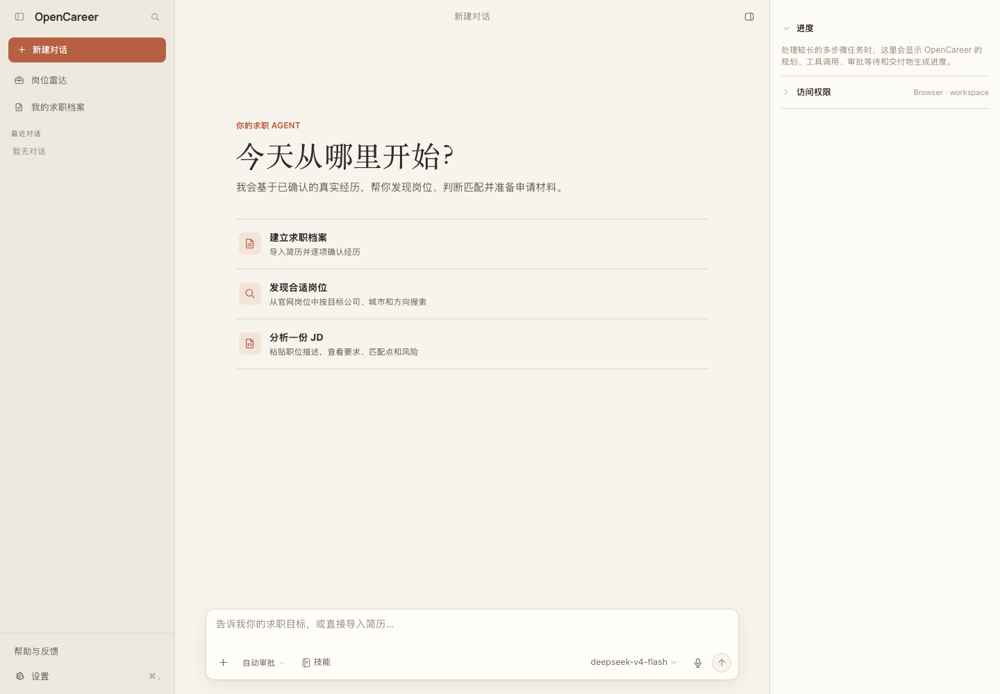
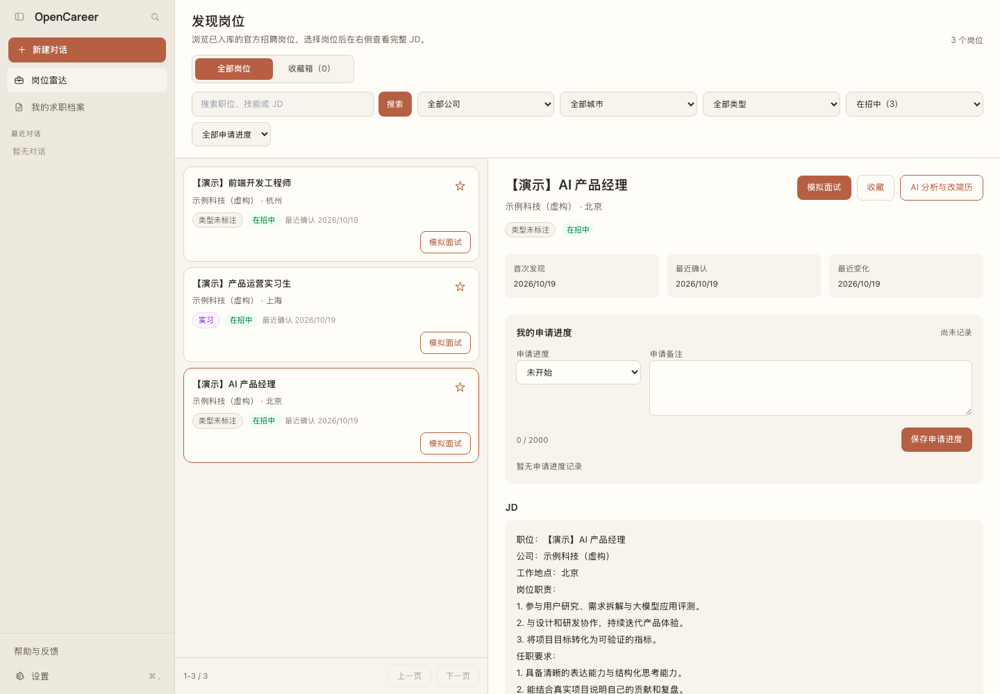
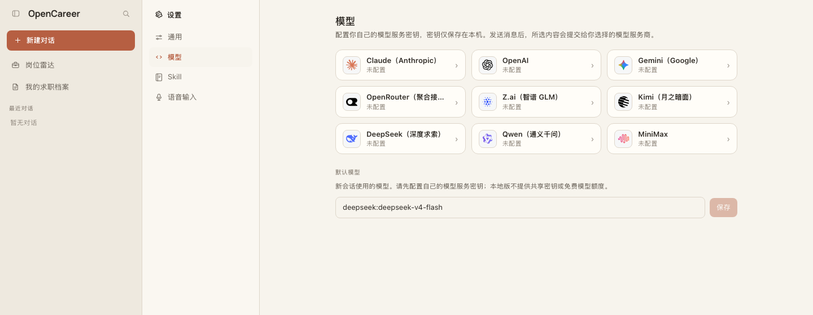
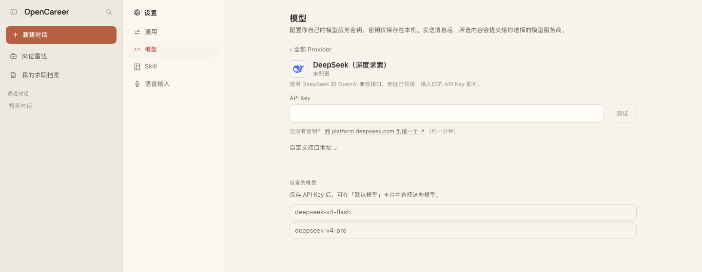
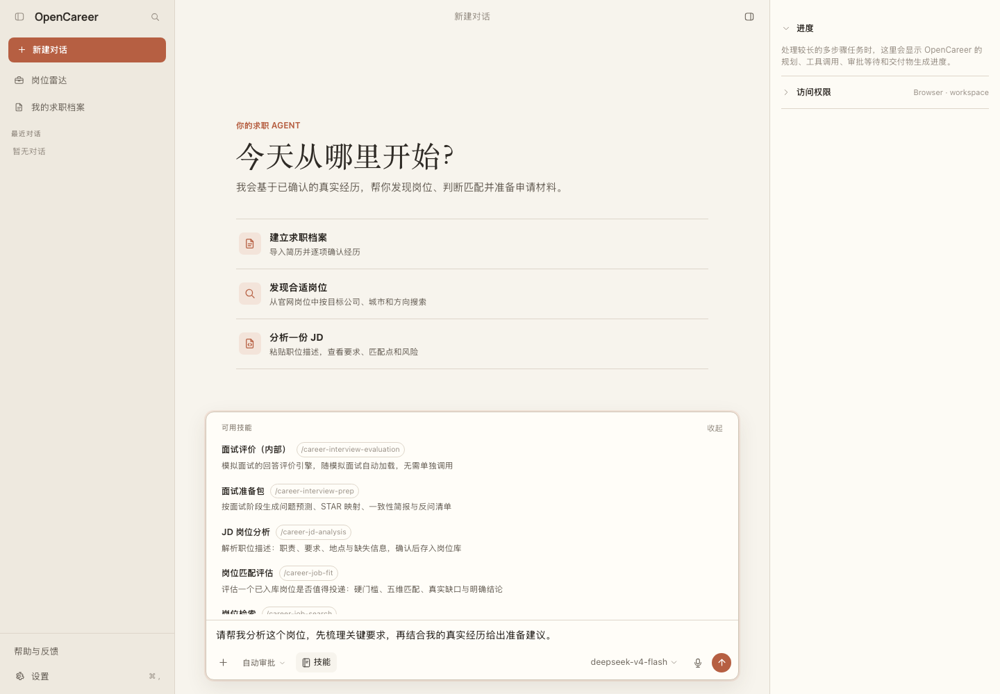

<div align="center">


# OpenCareer

### 从找到岗位，到准备好下一场面试。

面向中国 AI / 互联网岗位的开源求职助手。<br />
把岗位发现、简历梳理和模拟面试，放进同一个工作空间。

[](https://github.com/qiushibang/OpenCareer/actions/workflows/ci.yml)
[](LICENSE)
[](#本地安装与启动)

[在线体验](https://app.opencareer.online) · [本地安装](#本地安装与启动) · [首次配置](#第一次打开需要配置什么) · [问题反馈](https://github.com/qiushibang/OpenCareer/issues)

</div>



> **当前版本：源码本地网页版测试版。** 可以在线使用，也可以在自己的电脑上部署。
> 项目基于 [OpenWorker](https://github.com/andrewyng/openworker) 二次开发，保留其会话、工具、权限和多模型能力。它不会自动投递，也不会替你编造简历经历。

<p align="center"><a href="#你可以用它做什么">功能预览</a> · <a href="#本地安装与启动">安装启动</a> · <a href="#第一次打开需要配置什么">模型配置</a> · <a href="#完成你的第一条求职流程">上手流程</a> · <a href="#数据备份与升级">备份升级</a> · <a href="#常见问题">常见问题</a></p>

## 你可以用它做什么

| 找到值得准备的岗位 | 把真实经历讲清楚 | 提前练习面试 |
| --- | --- | --- |
| 浏览公开官方招聘信息，按公司、城市等条件筛选；也可以导入一份岗位描述。 | 导入简历，逐项核对事实，再围绕目标岗位分析优势、缺口与表达方式。 | 根据岗位和已确认简历进行多轮模拟面试，保留历史和复盘。 |
| 收藏岗位，记录申请进度和备注。 | 管理多份简历，不把模型猜测当成个人经历。 | 练习之后继续追问，把复盘落实到下一次回答。 |



<sub>文档图片来自真实本地页面。标有「演示」的岗位与公司均为虚构数据，不是真实招聘信息，也不会预装到你的数据库。</sub>

### 在线版与本地版怎么选

| | 在线体验 | 本地网页版 |
| --- | --- | --- |
| 入口 | [app.opencareer.online](https://app.opencareer.online) | 电脑上的浏览器 |
| 安装 | 无需安装 | 安装运行环境后，用一条命令启动 |
| 账号 | 网站注册／登录 | **不需要网站账号或 Authing 登录** |
| 模型 | 自行配置服务商密钥 | 自行配置服务商密钥 |
| 数据 | 托管服务内按用户隔离 | 保存在自己的电脑上 |
| 数据同步 | 与本地版不自动互通 | 不拉取线上岗位库、简历或历史对话 |

**本地部署不等于完全离线。** 使用云端模型时，参与本轮分析的对话、岗位或简历内容会发送给所选模型服务商；下载依赖和获取公开招聘信息也需要网络。软件沿用 MIT 许可证，模型服务商可能另行收费。

## 本地安装与启动

### 1. 准备运行环境

| 环境 | 本项目推荐 | 用途与安装入口 |
| --- | --- | --- |
| Git | 当前稳定版本 | 下载、更新源码：[官方安装说明](https://git-scm.com/downloads/) |
| Python | **3.12** | 运行后端：[官方下载](https://www.python.org/downloads/)；选择 3.12 系列 |
| Node.js | **22 LTS（Long-Term Support，长期支持版）** | 构建和提供网页：[官方下载](https://nodejs.org/en/download)；选择 22 系列，包含 npm 包管理器 |
| 浏览器 | 更新的 Chrome / Edge / Firefox / Safari | 本版样式最低要求：Chrome / Edge 111、Firefox 128、Safari 16.4；建议使用最新稳定版本 |

当前已有 macOS 本机和 Linux 自动化验收。Windows 原生启动与桌面安装包**尚未完成验收**；Windows 用户可先使用在线版，熟悉 Linux 的用户可在 WSL（Windows Subsystem for Linux，适用于 Windows 的 Linux 子系统）中尝试以下流程，并在子系统内安装上述环境。

安装后重新打开终端，检查命令是否可用：

```bash
git --version
python3 --version
node --version
npm --version
```

如果 `python3` 不是 3.12，但已安装 `python3.12`，后续命令中的 `python3` 请替换为 `python3.12`。Linux 若提示缺少 `venv` 或 `ensurepip`，先通过系统包管理器安装对应 Python 版本的虚拟环境组件。

**不需要准备** Docker、数据库服务器、Authing 应用、维护者账号或线上配置文件。不要复制生产 `.env` 文件，也不要使用他人提供的共享密钥。

### 2. 下载源码，启动项目

在你希望存放项目的目录打开终端，依次执行：

```bash
git clone https://github.com/qiushibang/OpenCareer.git
cd OpenCareer
python3 start_local.py
```

第一次启动会自动创建 `.venv-local/` 独立 Python 环境、安装前后端依赖、构建页面，然后启动本地服务并尝试打开浏览器。**首次安装需要联网，耗时取决于下载速度；请保留终端窗口。**

看到「OpenCareer 本地版已启动」后，打开：

**[http://127.0.0.1:1422](http://127.0.0.1:1422)**

如果浏览器没有自动打开，手动访问终端打印的地址即可。不要把 `127.0.0.1` 替换成其他域名；本地版有来源校验，默认只允许本机访问。

### 3. 停止、再次启动与更换端口

在运行项目的终端按 **Ctrl+C** 停止服务，**不会删除数据**。下次进入同一个项目目录，再执行：

```bash
python3 start_local.py
```

依赖未变化时会复用已安装环境，网页仍会重新构建。需要时可使用以下选项：

```bash
# 只启动服务，不自动打开浏览器
python3 start_local.py --no-browser

# 默认端口被占用：指定两个不同的空闲端口
python3 start_local.py --port 1423 --backend-port 8768

# 自定义数据位置：首次必须选择空目录，后续一直使用相同目录
python3 start_local.py --data-dir "/path/to/opencareer-data"
```

上面的 `/path/to/opencareer-data` 是示例路径，请替换成你自己电脑上的目录。使用 `--port 1423` 后，访问地址也变为 `http://127.0.0.1:1423`。端口冲突时启动器会退出，不会停止其他程序。

## 第一次打开需要配置什么

**要使用 AI 对话，必须先配置至少一家模型服务商的密钥，并选择对应模型。** 页面显示了模型名称，并不代表已经附赠密钥或免费额度。

### 第一步：选择服务商

点击左下角 **设置 → 模型**。也可以从输入框的模型菜单进入「配置自定义模型」。



界面提供 DeepSeek、Kimi、Qwen、Z.ai、MiniMax、OpenAI、Claude、Gemini、OpenRouter。只配置你准备使用的一家即可，不需要全部配置。服务商可用性、模型权限和费用以对应账号为准。

### 第二步：填写密钥，测试连接

以 **DeepSeek（深度求索）** 为例：点击对应卡片，通过页面内的官方入口创建自己的 **API Key（Application Programming Interface Key，接口访问密钥）**，复制到输入框后点击 **测试**；校验通过会保存并返回服务商列表。



| 配置项 | 是否必需 | 怎么填写 |
| --- | --- | --- |
| 服务商 | 必需 | 选择与你的密钥所属平台一致的服务商 |
| API Key | 必需 | 从该服务商的开发者平台创建；不是网页登录密码，也不是短信验证码 |
| 接口地址 | 通常无需修改 | 保留预填的官方地址；区域账号需使用对应受支持的官方端点 |
| 默认模型 | 必需 | 返回模型列表后，在「默认模型」中选择或填写有权调用的模型并保存 |
| 语音输入 | 可选 | 文字使用无需配置；浏览器语音识别依赖另行配置的服务和麦克风权限 |
| 扫描件文字识别 | 可选 | 文字型 PDF / DOCX 无需额外组件；扫描版 PDF 需要额外安装识别组件 |

本地网页版目前沿用受限的服务商安全范围，**不支持随意填写第三方中转地址，也不承诺 Ollama 等本地模型接入**。如果提示“只允许受支持的官方地址”，请核对服务商和地区，不要关闭安全校验。

> 密钥存放在本机的数据目录中，不需要写进源码或提交到 GitHub。请像保护密码一样保护密钥和数据备份；不要截图公开密钥。网页会员订阅不一定包含接口调用额度，出现余额或权限错误时，需要到对应服务商平台核对。

### 第三步：选定模型，发送第一条消息

回到服务商列表，在「默认模型」卡片中选择模型并点击 **保存**。再新建一条对话，检查输入框右下方显示的是你刚配置的模型。

可以先发送一条不含个人信息的消息：

> 我想准备 AI 产品经理岗位的面试。请先问我三个问题，帮助我明确准备方向。

收到正常回复后，再开始导入简历或岗位。模型可能按调用量收费；遇到认证、限额或余额错误，请先检查模型设置，不要反复提交敏感材料。

## 完成你的第一条求职流程

### 从一份真实岗位描述开始

如果岗位雷达为空，这是新安装的正常状态，本地版不会复制线上数据库。你可以先粘贴一份公开岗位描述，并附上公司、职位和原始招聘链接：

> 请先解析下面的岗位描述，列出关键职责与要求。需要入库时先给我预览，等我确认后再保存。

JD 是 Job Description（职位描述）。也可以通过对话请求采集已支持的公开官方招聘来源；采集范围与操作审批以页面提示为准。某个招聘来源失效时，仍可使用手动描述，不绕过登录、验证码或访问限制。

### 导入简历，确认经历，再开始面试

通过首页「建立求职档案」或输入框 **＋** 中的简历导入入口，提交文字型 PDF、DOCX 或粘贴的简历文本。核对提取结果，逐项确认经历后，再在「我的求职档案」中管理简历。

有了岗位和已确认简历，就可以在岗位详情点击 **AI 分析与改简历** 或 **模拟面试**，按弹窗选择简历；模拟面试还可以选择时长和难度。请确认模型改写没有增加你未做过的项目、指标或职责。

### 用技能快速进入具体任务

点击输入框下方的 **技能**，选择岗位分析、简历指导或面试准备等任务，再描述自己的需求。选择技能不会替你发送消息，也不应清空已输入的普通草稿。



<details>
<summary><strong>可选：安装扫描版 PDF 的文字识别组件</strong></summary>

基础启动不自动安装 OCR（Optical Character Recognition，光学字符识别）组件。请先成功完成基础启动，再停止服务，并在项目目录中执行：

```bash
.venv-local/bin/python -m pip install -e ".[ocr]"
python3 start_local.py
```

以上命令适用于 macOS / Linux 环境。安装需要下载额外依赖，扫描件质量会影响识别效果。它不代表所有平台的离线打包已经验收；原生 Windows 仍待验证。遇到识别失败，可先换用文字型 PDF、DOCX 或粘贴文本。

</details>

<details>
<summary><strong>可选：配置语音输入</strong></summary>

文字使用无需语音配置。如果需要语音，进入 **设置 → 语音输入**，查看「火山引擎模拟面试语音」卡片；语音服务凭证与对话模型的密钥不是同一份。

使用自己开通的火山引擎语音服务，按平台对应鉴权方式填写语音 API Key，或旧版的 App ID（Application Identifier，应用标识）与 Access Token（访问令牌）。按页面要求填写 ASR（Automatic Speech Recognition，自动语音识别）与 TTS（Text-to-Speech，语音合成）的资源标识及 Speaker ID（音色标识），保存后允许浏览器使用麦克风。

浏览器语音会把音频交给你配置的语音服务处理，可能产生服务费用；不要把它当作离线识别。桌面 Whisper 设置不适用于本地网页版。真人麦克风和不同语音账号的完整链路仍需在你的设备上验证，未开通服务时请继续使用文字输入。

</details>

## 数据备份与升级

默认数据放在项目目录下的 `.local-state/local-user/`，与线上服务相互独立：

```text
.local-state/local-user/
├── state/       # 对话、设置及模型密钥
├── career/      # 岗位等业务数据库
├── private/     # 私有简历文件
├── workspace/   # 本地专用工作区和技能配置
└── web/         # 可重新生成的网页构建产物
```

**备份**：先停止服务，再复制整个数据目录到安全位置。备份包含密钥和简历，请加密保存，不要上传到公开仓库，也不要把整个目录作为问题附件。

**升级**：先停止服务、备份数据并记录当前版本，然后更新源码、重新启动：

```bash
git rev-parse HEAD
git pull --ff-only
python3 start_local.py
```

如果你使用自定义 `--data-dir`，升级后仍须带上原来的参数。若更新提示本地改动冲突，请先保留自己的修改，不要强制覆盖。回退时应恢复**匹配的旧源码和数据备份**，不能只退代码而继续使用已经迁移的新数据库。

## 常见问题

| 问题 | 优先检查 |
| --- | --- |
| 提示找不到 `python3` / `node` / `npm` | 安装对应环境后重开终端，先运行版本检查命令 |
| 下载依赖失败或安装很慢 | 检查网络、证书和包源可达性，解决后重新运行启动器；不要通过关闭证书校验解决 |
| 提示端口被占用 | 用 `--port` 和 `--backend-port` 指定不同的空闲端口 |
| 页面打不开，或提示来源不允许 | 保持终端运行，访问它打印的 `http://127.0.0.1:端口`；不要替换主机名 |
| 显示模型名称，却不能回复 | 配置该服务商的密钥、测试连接并保存默认模型；模型名称不代表已授权 |
| 密钥测试失败、余额不足或模型不存在 | 核对密钥所属平台、区域、接口额度及模型权限；不要把网站会员账号当成接口凭证 |
| 岗位列表为空 | 新安装不附带线上岗位库；先手动导入岗位或请求采集受支持的官方来源 |
| 扫描件无法提取文字／语音不能用 | 这些是可选能力；先使用文字型简历和键盘输入，再单独配置所需组件 |

更多操作说明见 [本地部署指南](docs/22_LOCAL_QUICKSTART.md)。报告问题时请附操作系统、运行环境版本、复现步骤和**脱敏后的错误文字**，不要附密钥、完整简历、验证码或原始数据目录。

## 安全与使用边界

本地启动器是**单用户、仅本机可访问**的服务，不是公网部署方案。不要通过隧道、端口转发或反向代理把免登录本地版暴露给其他人；想直接在线体验，请使用托管网站。

外部网页、岗位文本和用户输入都不能替代安全边界。关键业务操作仍受工具权限与确认规则限制；AI 输出需要本人复核，不用于自动投递、简历造假或绕过招聘平台规则。

依赖风险及处理记录见 [SECURITY.md](SECURITY.md)。发现漏洞时，请使用 [私密漏洞报告](https://github.com/qiushibang/OpenCareer/security/advisories/new)，不要在公开 Issue 中发布可利用细节。

## 开发与贡献

欢迎改善招聘来源适配、安装体验、文档与测试。开始前请阅读 [贡献指南](CONTRIBUTING.md)、[AGENTS.md](AGENTS.md) 和 [文档导航](docs/README.md)。求职能力主要位于 `extensions/career_mcp/`，网页位于 `surfaces/gui/`；保留 OpenWorker 核心与求职领域扩展的边界。

当前未提供经过验收的 Docker 一键包或已签名桌面安装包。不要用上游 OpenWorker 的安装包替代本项目，也不要把源码发布等同于线上服务更新。

## 许可证与致谢

沿用 [MIT 许可证](LICENSE)，保留 [OpenWorker](https://github.com/andrewyng/openworker) 的原始版权和来源声明。固定上游基线及二次开发范围见 [UPSTREAM.md](UPSTREAM.md)。第三方依赖、模型和素材遵循各自许可证。

OpenCareer 是独立的社区衍生项目，不代表上游官方发行版。
