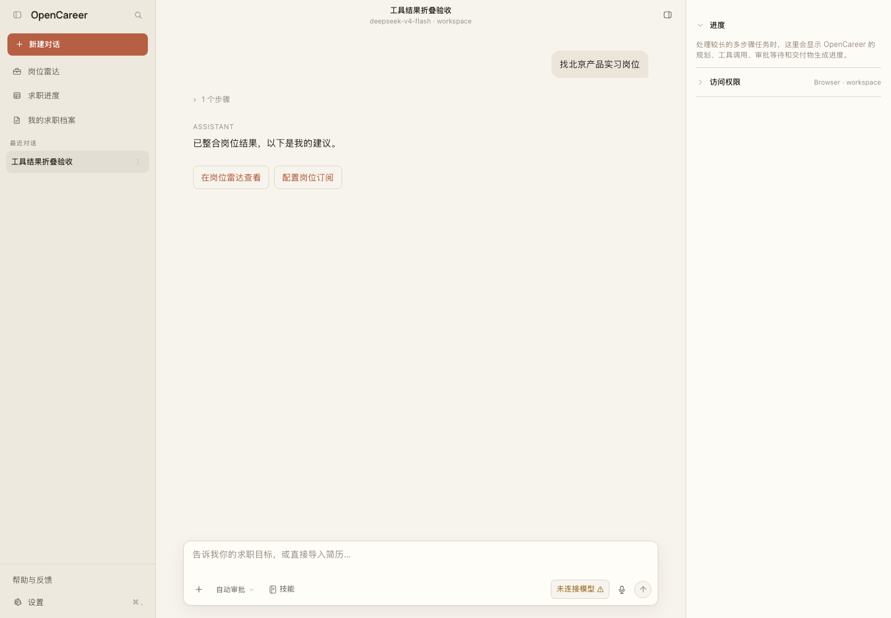
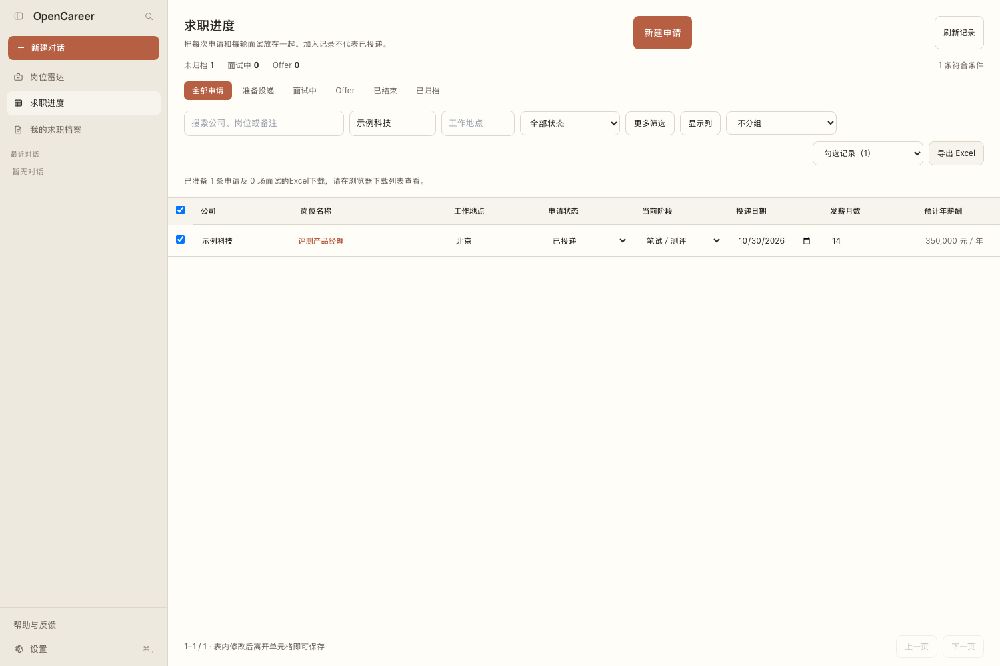
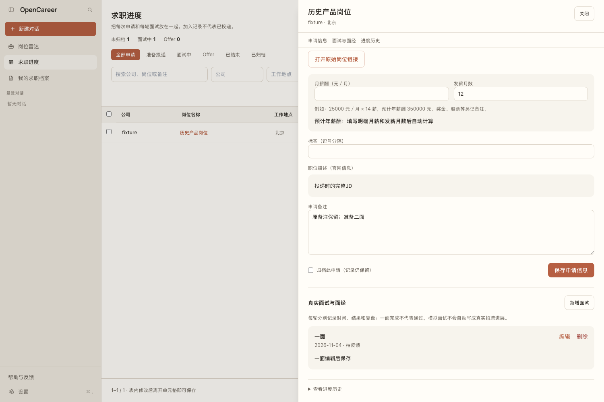

<div align="center">


# OpenCareer

**面向中国 AI / 互联网岗位的开源求职工作台**

发现机会，整理经历，管理投递，准备面试。<br />在自己的电脑上运行，用自己选择的模型，让求职过程有条理地向前推进。

[](https://github.com/qiushibang/OpenCareer/actions/workflows/ci.yml) [](LICENSE) [](#快速开始)

**[在线体验 ↗](https://app.opencareer.online)**　·　**[本地安装 ↓](#快速开始)**　·　[使用指南](docs/GETTING_STARTED.md)　·　[反馈问题](https://github.com/qiushibang/OpenCareer/issues)

</div>

<br />

## 把分散的求职过程，放进一个工作台

| 发现机会 | 做好准备 | 跟进进展 |
| :--- | :--- | :--- |
| **岗位雷达** · 浏览公开官方招聘信息，按公司、城市、业务线和岗位方向筛选。 | **简历与岗位分析** · 导入简历、确认经历，围绕目标岗位梳理优势与表达。 | **求职进度表** · 管理投递状态、薪酬和标签，保存逐轮面试与面经，导出 Excel。 |
| **自然语言查询** · 用对话组合复杂条件，并跳转到雷达逐一查看岗位。 | **模拟面试** · 结合岗位描述和已确认简历练习多轮问答，保留复盘。 | **每日岗位订阅** · 与 AI 确认条件，预览草稿后启用，推送到已连接渠道。 |

### 01 / 找到值得准备的岗位

直接浏览岗位雷达，也可以把筛选要求交给 AI。岗位保留官网链接，新增、更新、重新开放和历史补录分别记录。

> “帮我找北京的 AI 产品实习岗位，优先看豆包相关业务，排除需要博士学历的岗位。”



### 02 / 管理每一次投递与面试

从雷达加入申请，或手动记录其他渠道的岗位。在表格中维护进度，逐轮保存面试时间、结果和面经；需要备份时，一键导出 `.xlsx`。



<details>
<summary><b>查看逐轮面试与面经</b></summary>

<br />



</details>

### 03 / 让合适的机会，按时来到你面前

点击「在对话中创建订阅」，告诉 AI 你关注的公司、城市和方向。确认筛选条件、接收渠道和发送时间后，再启用每日推送。

飞书支持扫码连接；飞书、钉钉和企业微信也支持群机器人配置。默认北京时间 09:00 发送，可自行修改。本机服务需要保持运行。

> “每天早上 9 点，把北京的产品实习岗位发到我的飞书，只看新增岗位。”

[查看订阅配置与发送规则 →](docs/24_JOB_QUERY_AND_SUBSCRIPTIONS.md)

<sub>封面为品牌概念插画；上方为真实界面截图。截图可能与最新样式略有差异，标有「演示」的公司与岗位是虚构数据，不随安装预置。截图不代表实时招聘状态。</sub>

<br />

## 快速开始

准备 **Git、Python 3.12、Node.js 22** 和现代浏览器，然后在终端依次执行：

```bash
git clone https://github.com/qiushibang/OpenCareer.git
cd OpenCareer
python3 start_local.py
```

首次启动会安装依赖并构建网页，需要联网。保留终端窗口，按提示打开 **[http://127.0.0.1:1422](http://127.0.0.1:1422)**。停止时按 `Ctrl+C`，下次运行同一启动命令即可，数据会保留。

**第一次打开，只需先完成这三件事：**

1. **连接模型**：点击输入框的「未连接模型」，选择服务商，填写自己的接口密钥，测试连接并保存默认模型。模型调用费用由对应服务商收取。
2. **查看岗位**：进入岗位雷达，等待公共岗位目录同步；也可以粘贴一份职位描述开始分析。浏览岗位不需要模型密钥。
3. **建立档案**：首页点击「建立求职档案」，导入 PDF / DOCX 简历并确认事实，再开始岗位分析或模拟面试。扫描件识别和语音是可选配置。

本地版不需要网站账号、Docker 或数据库服务器。macOS 与 Linux 已有验收记录；Windows 原生启动和桌面安装包尚未完成验收。

[完整安装与首次配置 →](docs/GETTING_STARTED.md)　·　[更换端口、数据目录与独立采集 →](docs/22_LOCAL_QUICKSTART.md)

## 在线体验，还是本地部署？

| | 在线体验 | 本地网页版 |
| :--- | :--- | :--- |
| 开始使用 | 打开网站，注册／登录 | 克隆源码，运行启动命令 |
| 数据保存 | 托管服务按用户隔离 | 保存在自己的电脑上 |
| 模型配置 | 自行提供服务商密钥 | 自行提供服务商密钥 |
| 岗位来源 | 托管服务提供 | 默认同步公共岗位目录，也可独立采集 |
| 适合 | 快速体验，无需安装 | 自主管理数据、使用最新开源能力 |

开源本地版与线上版本独立发布，功能可能不同。公共岗位同步不包含线上用户的简历、对话、收藏或密钥；岗位目录覆盖已支持的公开官方来源，不代表全网全部岗位。

本地部署仍可能联网：使用云端模型时，本轮分析所需内容会发送给你选择的服务商。本地服务默认仅限本机访问，不适合作为免登录公共网站暴露。

## 按需要继续探索

| 想做什么 | 从这里开始 |
| :--- | :--- |
| 安装、配置模型、备份与解决启动问题 | [安装与使用完整指南](docs/GETTING_STARTED.md) |
| 配置每日订阅，或供其他 Agent 调用岗位工具 | [岗位查询、订阅与模型上下文协议（Model Context Protocol，MCP）接入](docs/24_JOB_QUERY_AND_SUBSCRIPTIONS.md) |
| 管理申请、面试与 Excel 导出 | [求职进度指南](docs/25_APPLICATION_WORKSPACE.md) |
| 使用浏览器、连接器与授权文件夹 | [本地访问权限](docs/27_LOCAL_ACCESS.md) |
| 了解岗位来源、同步和独立采集 | [岗位采集与分发](docs/23_JOB_CATALOG_DISTRIBUTION.md) |
| 参与开发、提交问题或报告漏洞 | [贡献指南](CONTRIBUTING.md) · [安全说明](SECURITY.md) · [文档导航](docs/README.md) |

## 开源与致谢

OpenCareer 基于 [OpenWorker](https://github.com/andrewyng/openworker) 二次开发，复用其会话、工具、权限和多模型能力。求职领域模块位于 `extensions/career_mcp/`，网页位于 `surfaces/gui/`。

沿用 [MIT 许可证](LICENSE)，保留上游版权与[来源说明](UPSTREAM.md)。本项目是独立的社区衍生版本。AI 建议需要本人复核；项目不自动投递，不生成虚构经历，不绕过招聘平台访问限制。

<div align="center">

<br />

**从找到岗位，到准备好下一场面试。**

[开始使用](#快速开始)　/　[提交反馈](https://github.com/qiushibang/OpenCareer/issues)　/　[参与贡献](CONTRIBUTING.md)

</div>
