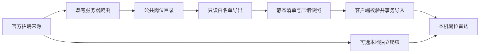

# 岗位数据的采集与分发方案

## 决策

默认采用集中采集、客户端同步；同时保留本地独立采集作为可选模式。
服务器使用现有官方来源爬虫及公共 Catalog（岗位目录），定期导出静态压缩快照。
用户首次启动下载完整目录，之后每 24 小时检查；未变化来源不重复导入。
网页先启动，同步在后台完成，不依赖模型密钥、Authing 登录或生产数据库凭据。

| 方案 | 新用户体验 | 运维与资源 | 定位 |
|---|---|---|---|
| 集中采集、静态快照同步 | 首次即可下载现有完整目录，后续只更新变化来源 | 维护者统一适配官网；用户仅下载压缩公开数据 | 默认 |
| 每台设备独立爬取 | 首次需等待完整轮次，受当地网络及浏览器环境影响 | 每用户独立维护浏览器与调度 | 可选、自托管和离线后的恢复方式 |

## 公共数据边界

只导出 `catalog.jobs.visibility_user_id IS NULL`、有爬虫来源、且关联
`job_sources.source_type = 'crawler'` 的记录；来源还必须属于已注册官方来源白名单。
列名显式枚举，禁止 `SELECT *`。不读取私有表，不导出手动岗位、用户标识、简历、
对话、收藏、申请进度、模型配置、访问令牌或原始错误响应。

来源白名单由服务器维护。客户端只接收经过结构和摘要校验的数据，不下载或执行
新适配器；维护者新增官方来源后，协议兼容的旧客户端也能同步新来源。已知来源的
公司／范围身份若改变则拒绝覆盖，避免同一标识被误用于不同来源。

导出连接强制只读、使用一致性快照；不执行迁移，不更改线上 Catalog。
静态文件放入现有网页挂载目录的专用子目录，不替换网页或重启线上容器。
导出器用独立定时任务和锁运行，失败保留旧清单，不能将半个导出结果交给客户端。

## 传输契约

入口为 `/public/jobs/v1/manifest.json`。清单包含版本、生成时间、每来源最后成功
采集时间、最近尝试状态、岗位数量、文件大小和 SHA-256（安全散列算法 256 位摘要）。
快照按来源拆分，文件名含内容摘要，写入后不修改；最后原子替换清单。

来源快照包含完整公开职位描述、官网链接、地点、招聘类型、在招／下线状态和实际
发现／确认／变化时间。失败来源仍可分发最近一次成功保存的岗位，必须显示其真实
确认时间，不将导出时间冒充官网确认时间。数量不同于“今天全来源采集成功”。

客户端只从固定 HTTPS（超文本传输安全协议）来源读取，拒绝跨来源重定向、任意
下载路径、超大响应、错误摘要、重复岗位和非法结构；先完整校验单个来源，再事务
写入。导入沿用岗位身份、标准化和版本逻辑，保留本地岗位标识及用户收藏／申请记录。
重复同步相同版本不制造新版本；失败不删除已有岗位，不按下载失败推断岗位下线。

## 更新与失败恢复

服务器既有爬虫每日运行；静态导出任务定期发布当前一致性快照。客户端运行中每
24 小时检查，并支持“更新岗位”。关闭应用时不要求电脑继续运行后台服务；下次
启动补做过期检查。同步失败时显示原因分类，继续使用本机已有数据并有限退避重试。

本地独立模式使用 `--job-source local`，沿用 36 个已注册来源、12 小时调度、断点
续跑、失败隔离与浏览器安装。`--no-job-sync` 允许完全离线查看已有岗位。
集中模式不强制安装浏览器；本地模式才准备已有 browser 可选依赖及 Chromium。

## 验收要求

必须证明：生产导出只含上述公共记录；新安装能取得完整快照并在真实雷达中显示；
再次同步不重复入库，改动／下线生效且收藏、申请备注保持；坏摘要／断流／半发布
不污染数据；每日调度、进程退出、失败重试可观察；线上健康与容器启动时间不变。

来源适配问题独立记录：滴滴、月之暗面和腾讯部分 scope 的旧契约／数量上限问题
不能通过伪造成功或放宽缺失／下线保护解决。集中目录可提供它们已保存的公开历史，
同时保留失效提示；继续依据官网公开接口和本地 fixture 修复，禁止绕过访问限制。

本文是目标方案。实现、线上静态入口、定时器和真实同步的最终证据需追加到开发日志，
未通过实际验收前不能将设计描述视为已完成交付。
