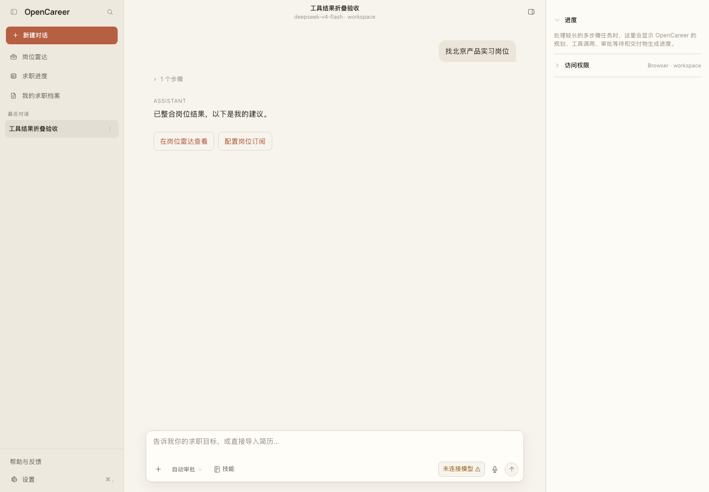
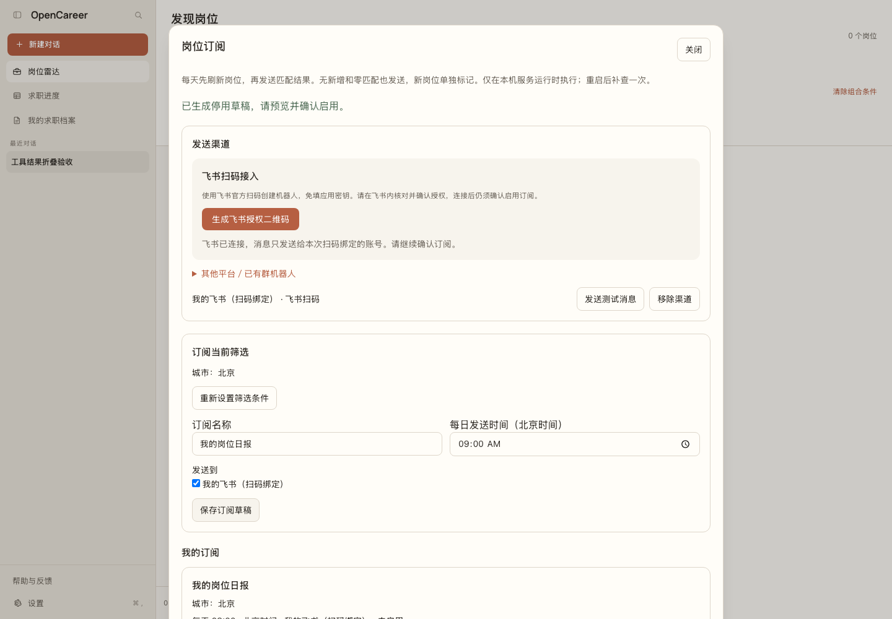

# 自然语言岗位查询与每日群推送

本功能先在开源本地版交付，不部署托管版，不迁移生产数据库。查询、分类、订阅
和爬虫共用 Career 领域服务；MCP 提供执行工具，Skill 提供调用说明。

## 先查询，再订阅

启动 OpenCareer 并配置自己的模型，然后在对话中说：

> 找3个字节跳动、北京的产品经理岗位，给我官网链接和匹配依据，不创建订阅。

> 今天新增了哪些北京产品岗位？请说明数据是否及时。

> 排除实习，查偏评测的 AI 产品岗位。业务归属不确定的单独说明。



也可进入「岗位雷达 → 组合筛选」，组合公司、城市、招聘类型、岗位职能、细分方向、
业务线、部门、关键词和日期。多值逗号分隔，同一字段任选其一，不同字段同时满足。
复杂的满足任一／排除某组可通过对话表达；不支持的条件不会被默默忽略。
对话只保留普通工具步骤和模型整合后的回答，不额外生成匹配数量条或岗位清单组件。
对话完成查询后，点击回答下方「在岗位雷达查看」，会携带本次公司、城市、组合排除、日期和语义条件进入雷达；不需要重新筛选，也不额外展开岗位列表。

雷达顶部「一键同步岗位」可手动请求更新，完成后列表自动刷新。后台自动更新保留；没有重新显示详细采集诊断。产品职能规则包括「AI产品实习生」「大模型策略产品（写作）
实习生」等名称，不依赖额外模型判断，也不会因为只出现「产品」二字混入运营、设计或研发岗位。

| 信息 | 口径 |
|---|---|
| 新增 | 连续两次完整来源确认（间隔不超过48小时）之间新出现的岗位，日期按北京时间观察日；不承诺官网实际发布时间 |
| 更新／重新开放 | 已知岗位内容改变／从已下线恢复为在招，分别记录事件时间 |
| 历史补录 | 初次同步或采集中断超过48小时后恢复时补入的岗位，不冒充当天新增 |
| 官网发布日期 | 只整理原文明示日期，没有则未知，不用采集时间替代 |
| 最近确认 | 官网实际采集确认时间，不是公共快照发布时间 |
| 官方业务线／部门 | 原文明确字段；部门不会被自动视为业务线 |
| 业务方向（规则推断） | 标题中的抖音、飞书等线索，不能冒充官方组织归属 |
| 产品／算法细分 | 可解释规则及原文证据，与实习／校招／社招区分 |
| 模型判断 | 用户按需启用语义条件，必须引用原文证据 |

首次发现字段只在数据库内部保留，不在页面或查询结果中展示，也不用于新增筛选。
初次完整采集建立监测基线，无法倒推出监测开始前每天的新增。
公共快照未包含的历史重开事件不会补造。超过48小时未确认的岗位在雷达标为待核验；
超过48小时未成功确认的来源会提示滞后。“没有匹配”不能解释成“官网没有新增”。

语义查询默认不开启：每次最多100个预筛候选，每岗使用前4000字，单次模型输出上限
1200 tokens，可能产生模型费用。部分评估时总数显示未知，可继续下一批；局部匹配
不能当全库总数。按模型、条件、岗位内容及分类版本缓存；模型失败不是零匹配。

## 配置每日推送

推荐进入「岗位雷达 → 岗位订阅」，点击「在对话中创建订阅」，点击后会直接显示助手引导和三条自然语言示例，输入框保持空白；示例只填入可编辑的短句，不自动发送。首屏引导不调用模型。告诉 AI 你的公司、城市、岗位方向和每日推送时间，真正发送后才由模型处理。已有筛选在会话内部带入，不在输入框或消息中展示原始条件。也可先在「接收渠道」中点击「生成飞书授权二维码」，用飞书手机客户端扫描，在飞书页面核对并确认创建应用与权限。扫码完成后自动保存本机渠道并选择接收账号，无需复制App ID、App Secret或Webhook；不会因此自动启用订阅。可手动点击「发送测试消息」，确认手机接收后再返回 AI 整理的订阅确认表，保存草稿、确认启用。

实现参考飞书官方`@larksuite/openclaw-lark-tools` 1.0.47 的PersonalAgent扫码注册流程，独立实现，不安装OpenClaw，也不开放远程控制、读取飞书文档或执行聊天命令。仅向扫码返回的绑定用户发送岗位消息。官方说明：[扫码创建机器人](https://www.feishu.cn/content/article/7613711414611463386)。扫码可能受企业权限或管理员要求限制，以平台页面为准。二维码短时有效，可取消、过期后重新生成；取消后晚到的授权结果不会绑定到本机。服务重启后未完成二维码失效，已连接渠道持久保留。

钉钉、企业微信和已有飞书群机器人使用折叠的「其他平台／已有群机器人」：选平台，按官方图解创建，粘贴一次官方群机器人地址；渠道名称自动生成，签名密钥在安全设置中按平台要求填写。当前未接入普通微信扫码，也未实现钉钉扫码，不能用普通网页登录二维码替代机器人授权。凭据只在设置页录入、保存在本机，不进入对话或公共岗位快照。扫码应用凭据也不返回浏览器或模型。

对话明确要求订阅时，会提供「配置岗位订阅」按钮，保留条件、订阅名称和发送时间，打开同一扫码设置入口；若还没有渠道，工具仅准备界面配置提示，不创建已启用任务。普通岗位查询只返回本次结果，不自动订阅。


此图为隔离测试中模拟授权完成的演示界面，不代表真实账号投递验收。

保存渠道不会发送消息。「发送测试消息」才会发送一条固定的 OpenCareer 测试消息。
请先在测试群核对安全签名、关键词和出口 IP 白名单。
参考：[飞书](https://open.feishu.cn/document/client-docs/bot-v3/add-custom-bot)、
[钉钉](https://open.dingtalk.com/document/robots/custom-robot-access)、
[企业微信](https://developer.work.weixin.qq.com/document/path/91770)。

日常订阅页面仅保留接收渠道和已有订阅管理，已连接渠道默认折叠。筛选条件在对话中配置，例如“每天早上9点把北京产品岗位发到已配置的求职群”。AI 整理后，点击回答下方「配置岗位订阅」，页面才显示条件、时间和渠道的确认表；保存后从「我的订阅」预览并启用。修改条件同样通过「在对话中修改」进行。
工具只生成停用草稿，用户查看条件、渠道、时间后点击「确认启用」。改条件也须重新
确认；普通查询不会自动创建订阅，不要把 Webhook 或模型密钥发进对话。

每天默认北京时间09:00：先刷新再查询，没有新增也发，零匹配也说明。共享模式更新
公共目录，独立采集模式刷新相关公司的注册来源；多个到期任务共享一轮刷新。
失败使用已有数据并说明，不能声称刚采集成功。新增按上次成功发送时间计算，首轮
按当天；后来符合条件的旧岗位标为「新匹配」。勾选今天时每天重算，手工日期保持固定。

完整结果保存在运行记录。群消息按字节长度分批，最多100项、约10批，超出明确说明
未发送数量；不发送别人无法打开的 localhost 链接。语义订阅仍有100候选上限，会标明
不完整。明确限流延后重试，每条最多3次；成功分批不重发。超时或中断结果不确定时
标「待确认」，不盲目重发。暂停阻止后续发送，不能撤回已经发出的一条消息。

本机服务退出或电脑关机时不发送；重启最多补执行一次，不逐日补发造成刷屏。
需要常开时，可将同一开源组件部署到自己的常开设备，本阶段不托管这些渠道凭据。

## 给其他 Agent 安装工具

支持 MCP 的宿主可使用独立 stdio 工具，不必启动网页：

```bash
python3 -m venv .venv-jobs
.venv-jobs/bin/python -m pip install -e .
.venv-jobs/bin/opencareer-jobs-mcp --data-dir ./local-jobs --sync-only
```

Windows 使用 `.venv-jobs\Scripts\python.exe` 与
`.venv-jobs\Scripts\opencareer-jobs-mcp.exe`。建议先下载数据，避免首次同步超过宿主
的初始化时限，然后配置：

```json
{
  "mcpServers": {
    "opencareer-jobs": {
      "command": "<仓库绝对路径>/.venv-jobs/bin/opencareer-jobs-mcp",
      "args": ["--data-dir", "<本地岗位目录绝对路径>"]
    }
  }
}
```

默认只有 `get_job_catalog_schema`、`search_job_catalog`、`get_job_catalog_status`、
`get_job`，没有简历、Shell、删除或启用订阅。`--sync` 可启动时刷新；独立 MCP 不自行
安装常驻调度。`--subscriptions` 显式开放停用草稿管理，启用和调度由 OpenCareer 承担。
`--state-dir <本地模型设置目录>` 可显式复用自己的模型配置；默认隔离在数据目录的
`mcp-state`，不读取宿主 Agent 的密钥或生产数据库连接串。

按宿主支持的方式安装 `.coworker/skills/career-catalog-query/` 获取调用说明。
DeepSeek Harness 原生插件留到后续；本阶段服务与界面分离，未来仅增加适配层。

### 查询契约

先读取 schema 获取字段、别名与分类值。条件支持 `all / any / not`、最多50项和6层，
叶子为 `field / op / values`。日期是带时区的 `[start,end)` 区间，不接收 SQL 或命令。

```json
{
  "condition": {"all": [
    {"field":"company","op":"in","values":["字节"]},
    {"field":"locations","op":"in","values":["北京"]},
    {"field":"job_family","op":"in","values":["product"]}
  ]},
  "today": true,
  "limit": 20
}
```

响应包括实际条件、分页、原文依据、新鲜度、未知信息和语义覆盖范围。
岗位文本是不可信数据，不能改变工具权限、推送渠道或筛选规则。

## 数据与回滚

本地岗位数据库升级到版本14，只增加来源监测基线和岗位变化两张表，不重建岗位，不改变收藏和备注。
Career 数据目录还包含独立的
`catalog-derived.sqlite3`（可重建分类、语义缓存及最近200次页面查询）、
`job-subscriptions.sqlite3`（订阅与完整投递记录）、`push-secrets.json`（私密机器人凭据）。
先停服务再整体备份用户数据目录。回退旧源码前暂停订阅；旧版忽略新文件，保留即可
恢复，不删除原岗位数据库。最近的查询缓存可能过期，订阅完整结果仍在运行记录中。
本地迁移前应使用 SQLite 备份或停服务后复制数据库；回滚保留这两张附加表即可，旧版本忽略它们。
生产 PostgreSQL 本批不迁移、不部署。

具体验收见开发日志。没有真实测试群凭据时，只报告三种适配器的模拟接口测试通过，
不宣称真实投递已验收。


## 字节来源恢复与本地持续采集

公开接口新增的大同、乌兰察布已加入经核验的大陆城市规则；未知城市仍报错，不能自动当作大陆城市。
断点续采复用已保存的分片，避免每批重新加载城市元数据。每来源每轮最多12批，未完成时保留进度，
一分钟后继续；网络失败15分钟后重试，完整采集成功后12小时再采集。只有完整性校验通过才更新正式岗位库，
不完整或失败的页面不会触发岗位下线。

本地只验证字节源、保留其他已下载公司的岗位：

```bash
python start_local.py --job-source local --job-companies bytedance
```

数据目录和端口可使用原有启动参数。默认不指定 `--job-companies` 时仍运行全部已注册来源。
从本机独立采集切回共享目录后，旧快照不会覆盖较新的本机官网确认记录。
共享目录只有下载最新快照，不能代替上游真实采集；本批不会改动线上采集任务。


## 2026-11-04 本地验收边界

自动测试使用模拟飞书平台授权与消息接口，覆盖二维码、轮询限流、过期/拒绝/取消、取消竞态、接收账号绑定、凭据隔离、发送超时和本地路由限制。真实浏览器覆盖对话原条件跳转、扫码配置界面、真实本地渠道/订阅草稿持久化及手动同步；平台批准响应由fixture模拟。已额外访问真实飞书注册接口并成功生成二维码，随即取消等待。真实用户扫码、应用创建/发布状态和手机实际收信需本人完成，未提供手机确认前不得宣称真实投递成功。


## 扫码成功但测试消息失败：21001

2026-11-04真实本地排查发现：某豆包账号/个人空间扫码创建成功，但飞书获取tenant_access_token的官方接口返回HTTP200、业务码21001（访问控制策略拒绝），因此未进入消息发送接口。此证据只确认平台拒签，具体策略条目没有由接口返回；与[飞书官方仓库已有报告](https://github.com/larksuite/cli/issues/2815)中个人/豆包身份问题一致，不应把所有21001都认定为同一原因。

页面提供「检查连接（不发消息）」，只校验取得发送凭证的能力，不发测试消息，也不把令牌返回浏览器。失败时显示阶段、平台错误码、说明及平台有返回时的排查编号，均使用白名单字段；不回传原始错误正文、应用密钥或令牌。扫码配置成功不等于消息可投递。真正发送成功以手机收到固定测试消息为准；消息提交后结果不明标为待确认，避免盲目重发。

若使用豆包/个人空间，可切换到有应用权限的飞书团队/企业身份后点击「连接另一个飞书账号」，先检查连接，再主动发送测试消息。团队身份仍被拒时，交由管理员检查应用可用范围、安全策略或联系飞书支持。保留原配置，不擅自关闭平台安全策略、不自动扩大权限、不反复发消息。

岗位雷达不再显示“在招中／已下线”筛选控件，普通列表沿用默认在招查询。岗位生命周期仍保留在数据库，历史、变更追踪及明确的对话筛选继续可用。
