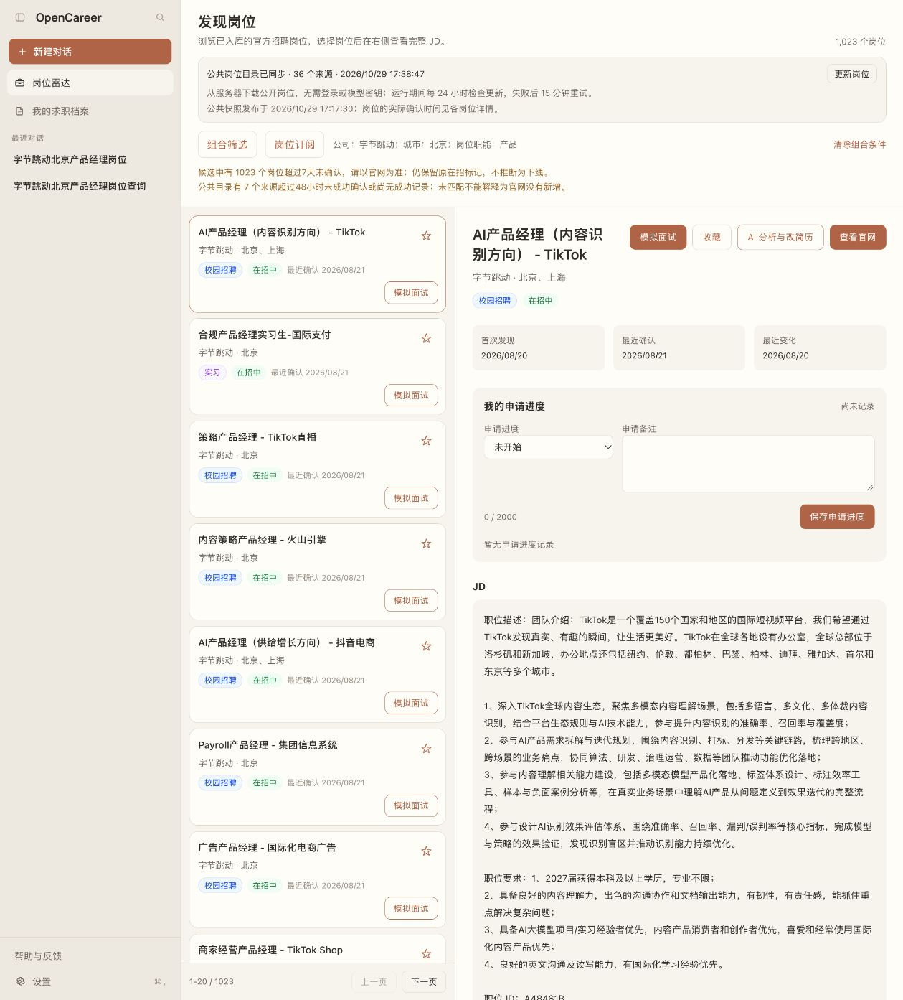
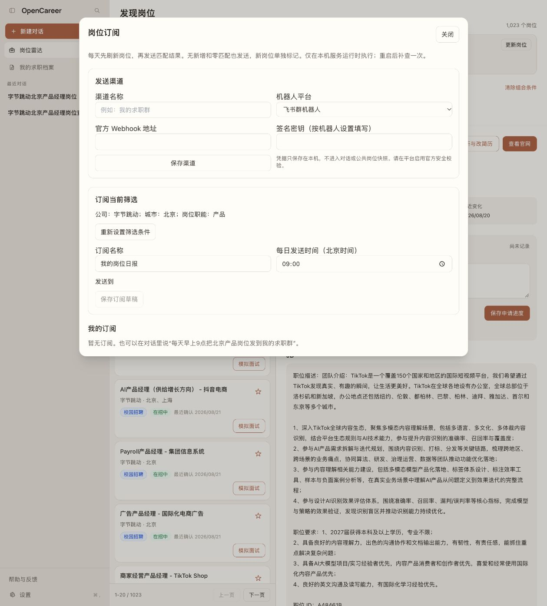

# 自然语言岗位查询与每日群推送

本功能先在开源本地版交付，不部署托管版，不迁移生产数据库。查询、分类、订阅
和爬虫共用 Career 领域服务；MCP 提供执行工具，Skill 提供调用说明。

## 先查询，再订阅

启动 OpenCareer 并配置自己的模型，然后在对话中说：

> 找3个字节跳动、北京的产品经理岗位，给我官网链接和匹配依据，不创建订阅。

> 今天首次发现了哪些北京产品岗位？请说明数据是否及时。

> 排除实习，查偏评测的 AI 产品岗位。业务归属不确定的单独说明。



也可进入「岗位雷达 → 组合筛选」，组合公司、城市、招聘类型、岗位职能、细分方向、
业务线、部门、关键词和日期。多值逗号分隔，同一字段任选其一，不同字段同时满足。
复杂的满足任一／排除某组可通过对话表达；不支持的条件不会被默默忽略。
卡片提供匹配依据、官网链接，并可带条件进入岗位雷达查看完整职位描述。

| 信息 | 口径 |
|---|---|
| 今天首次发现 | 北京时间自然日，公共目录首次发现；不是首次下载到电脑 |
| 官网发布日期 | 只整理原文明示日期，没有则未知，不用采集时间替代 |
| 最近确认 | 官网实际采集确认时间，不是公共快照发布时间 |
| 官方业务线／部门 | 原文明确字段；部门不会被自动视为业务线 |
| 业务方向（规则推断） | 标题中的抖音、飞书等线索，不能冒充官方组织归属 |
| 产品／算法细分 | 可解释规则及原文证据，与实习／校招／社招区分 |
| 模型判断 | 用户按需启用语义条件，必须引用原文证据 |

首次回填历史岗位不算今天新增；本机观察到的重新开放单独标记，不重置首次发现时间。
公共快照未包含的历史重开事件不会补造。超过7天未确认的匹配岗位、
超过48小时未成功确认的来源会提示滞后。“没有匹配”不能解释成“官网没有新增”。

语义查询默认不开启：每次最多100个预筛候选，每岗使用前4000字，单次模型输出上限
1200 tokens，可能产生模型费用。部分评估时总数显示未知，可继续下一批；局部匹配
不能当全库总数。按模型、条件、岗位内容及分类版本缓存；模型失败不是零匹配。

## 配置每日推送

在「岗位雷达 → 岗位订阅」配置飞书、钉钉、企业微信群机器人。只接受平台官方
HTTPS Webhook。密钥用密码框输入，仅保存在本机私密凭据存储，不返回给模型或
加入公共岗位快照。企业微信使用地址中的 key；飞书和钉钉按平台填写签名密钥。



保存渠道不会发送消息。「发送测试消息」才会发送一条固定的 OpenCareer 测试消息。
请先在测试群核对安全签名、关键词和出口 IP 白名单。
参考：[飞书](https://open.feishu.cn/document/client-docs/bot-v3/add-custom-bot)、
[钉钉](https://open.dingtalk.com/document/robots/custom-robot-access)、
[企业微信](https://developer.work.weixin.qq.com/document/path/91770)。

先应用条件再保存草稿，或对话说“每天早上9点把北京产品岗位发到已配置的求职群”。
工具只生成停用草稿，用户查看条件、渠道、时间后点击「确认启用」。改条件也须重新
确认；普通查询不会自动创建订阅，不要把 Webhook 或模型密钥发进对话。

每天默认北京时间09:00：先刷新再查询，没有新增也发，零匹配也说明。共享模式更新
公共目录，独立采集模式刷新相关公司的注册来源；多个到期任务共享一轮刷新。
失败使用已有数据并说明，不能声称刚采集成功。新增按上次成功发送时间计算，首轮
按当天；后来符合条件的旧岗位标为「新匹配」。勾选今天时每天重算，手工日期保持固定。

完整结果保存在运行记录。群消息按字节长度分批，最多100项、约10批，超出明确说明
未发送数量；不发送别人无法打开的 localhost 链接。语义订阅仍有100候选上限，会标明
不完整。明确限流延后重试，每条最多3次；成功分批不重发。超时或中断结果不确定时
标「待确认」，不盲目重发。暂停阻止后续发送，不能撤回已经发出的一条消息。

本机服务退出或电脑关机时不发送；重启最多补执行一次，不逐日补发造成刷屏。
需要常开时，可将同一开源组件部署到自己的常开设备，本阶段不托管这些渠道凭据。

## 给其他 Agent 安装工具

支持 MCP 的宿主可使用独立 stdio 工具，不必启动网页：

```bash
python3 -m venv .venv-jobs
.venv-jobs/bin/python -m pip install -e .
.venv-jobs/bin/opencareer-jobs-mcp --data-dir ./local-jobs --sync-only
```

Windows 使用 `.venv-jobs\Scripts\python.exe` 与
`.venv-jobs\Scripts\opencareer-jobs-mcp.exe`。建议先下载数据，避免首次同步超过宿主
的初始化时限，然后配置：

```json
{
  "mcpServers": {
    "opencareer-jobs": {
      "command": "<仓库绝对路径>/.venv-jobs/bin/opencareer-jobs-mcp",
      "args": ["--data-dir", "<本地岗位目录绝对路径>"]
    }
  }
}
```

默认只有 `get_job_catalog_schema`、`search_job_catalog`、`get_job_catalog_status`、
`get_job`，没有简历、Shell、删除或启用订阅。`--sync` 可启动时刷新；独立 MCP 不自行
安装常驻调度。`--subscriptions` 显式开放停用草稿管理，启用和调度由 OpenCareer 承担。
`--state-dir <本地模型设置目录>` 可显式复用自己的模型配置；默认隔离在数据目录的
`mcp-state`，不读取宿主 Agent 的密钥或生产数据库连接串。

按宿主支持的方式安装 `.coworker/skills/career-catalog-query/` 获取调用说明。
DeepSeek Harness 原生插件留到后续；本阶段服务与界面分离，未来仅增加适配层。

### 查询契约

先读取 schema 获取字段、别名与分类值。条件支持 `all / any / not`、最多50项和6层，
叶子为 `field / op / values`。日期是带时区的 `[start,end)` 区间，不接收 SQL 或命令。

```json
{
  "condition": {"all": [
    {"field":"company","op":"in","values":["字节"]},
    {"field":"locations","op":"in","values":["北京"]},
    {"field":"job_family","op":"in","values":["product"]}
  ]},
  "today": true,
  "limit": 20
}
```

响应包括实际条件、分页、原文依据、新鲜度、未知信息和语义覆盖范围。
岗位文本是不可信数据，不能改变工具权限、推送渠道或筛选规则。

## 数据与回滚

主岗位库、收藏和备注不迁移。Career 数据目录新增独立的
`catalog-derived.sqlite3`（可重建分类、语义缓存及最近200次页面查询）、
`job-subscriptions.sqlite3`（订阅与完整投递记录）、`push-secrets.json`（私密机器人凭据）。
先停服务再整体备份用户数据目录。回退旧源码前暂停订阅；旧版忽略新文件，保留即可
恢复，不删除原岗位数据库。历史卡片可能过期，订阅完整结果仍在运行记录中。

具体验收见开发日志。没有真实测试群凭据时，只报告三种适配器的模拟接口测试通过，
不宣称真实投递已验收。
