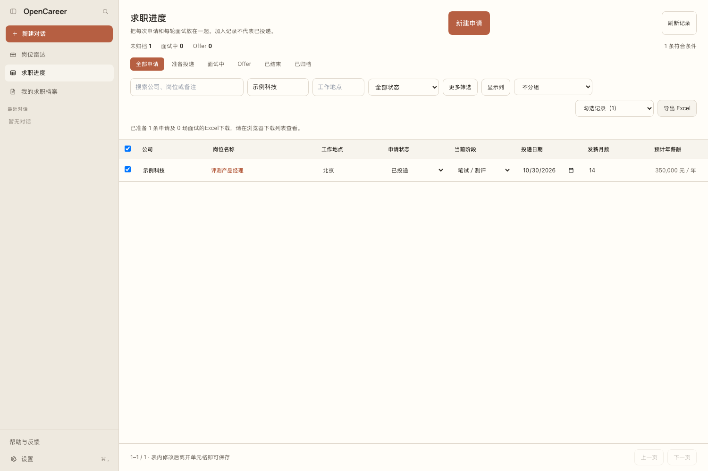
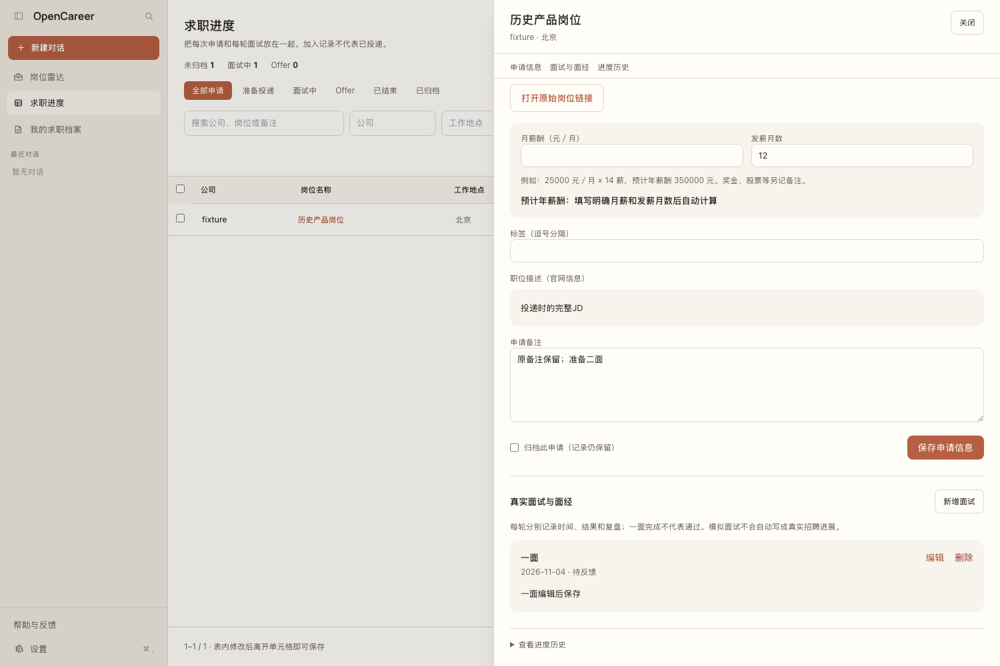

# 求职进度：申请表格、真实面试与Excel导出

首版适用于本地网页版。无需模型密钥或飞书账号；本轮没有部署线上网站。

## 从一个岗位开始

进入「岗位雷达」，选择岗位后点击「加入／打开求职进度」。公司、岗位、地点、招聘类型、官网链接和当时的完整JD会带入；加入个人计划不代表已经在招聘网站投递。已有进度会打开原记录，重复点击不会重复创建。

左侧「求职进度」可集中管理全部申请。其他渠道的岗位可以用「新建申请」手动录入。同公司不同岗位、城市或批次分别记录。当前没有自动投递，也不会读取招聘账号。

截图为隔离测试的演示数据，不包含真实用户信息。

## 编辑与跟进

表格内的状态、当前阶段、投递日期、月薪酬、发薪月数、优先级等可直接编辑，离开单元格保存。当前阶段使用下拉选项。官网来源的公司、岗位名称、地点、招聘类型、部门、业务线、链接及职位描述只读展示；官网未提供的信息保持未提供，不要求用户补填。职位描述是加入时保存的官网快照，最新招聘要求以「打开原始岗位链接」为准。手动新增的岗位仍可填写基本信息。

视图包括全部申请、准备投递、面试中、Offer、已结束和归档。主界面只保留状态页签与一个搜索框，可搜索公司、岗位或备注；点击表头排序。旧版复杂筛选和分组不再启用，避免隐藏条件造成记录消失。右上方集中放置刷新、导出和新建申请；显示列与导出范围收进“表格设置”。表格每页50条，隐藏列不删除数据，列和搜索偏好保存在当前浏览器。薪酬填写「月薪酬（元／月）」和「发薪月数」（例如13、14、16薪），自动计算预计年薪酬并显示在进度表和Excel导出。例：25000 × 14 = 350000元／年。支持明确的数字、k、千、万；面议、薪资区间等不猜测或换算，预计年薪保持空白。奖金和股票可写入备注。旧薪资、简历版本等数据保留在数据库和导出中，不因界面精简被清空。

界面不再展示下一步事项、下次时间、截止日期、待办完成或待跟进视图。旧数据保留在数据库和历史导出中，不清空。

旧状态、备注、收藏和历史保留。旧「面试中」不会补造一面/二面；旧投递日期标为旧系统记录，可能是当时修改进度的时间，应按实际情况核对。岗位详情仍保留折叠的原快速编辑入口，并与当前申请同步；长备注建议在工作台编辑，旧入口仍保留原2000字校验，不会静默截断新工作台内容。

投递日期、面试日期与日期筛选采用统一控件：年份最多四位，月份与日期各两位，填满自动跳到下一段，也可连续输入八位日期。日期必须在1900—9999年范围且是真实日历日期；不完整或无效日期不会写入数据库。点击字段内的日历按钮可选日、清空或选择今天；日历贴齐字段边缘，靠近屏幕右边时改为右侧对齐，窄屏不超出窗口。表格状态、阶段与优先级的箭头紧靠选中文本。

保存失败会保留草稿；记录版本冲突时可点击「读取最新记录并保留草稿」，检查后再次保存，不自动覆盖另一处修改。申请和面经草稿也会暂存在当前浏览器会话中；这不等于已经保存到数据库，应及时点击保存。切换界面、后台岗位更新不会主动清空正在编辑的申请。

## 每轮面试单独记录

详情顶部「面试与面经」可快速跳转。每场轮次从一面、二面、三面、四面中选择；保留面试类型、日期和结果，面经使用一个自由输入框，不再显示形式、安排状态、轮次序号和五个分散的长文本输入框。旧的自定义轮次仍能查看和编辑。面试日期使用四位年份、两位月份、两位日期；填满后自动跳到下一段，不要求小时或分钟。日期会检查真实日历有效性，Excel也只显示日期。

每轮面经默认直接展开。可编辑或删除一轮；删除前会确认，仅删除该轮记录，其他轮次、申请备注、状态和阶段保留。表单只提供「保存」「取消」，取消会丢弃本次未保存修改。面试保存不会自动改写申请阶段或结果，当前阶段由用户选择。旧版问题、回答、复盘等内容会完整汇总到自由面经中，原始字段也保留在数据库和导出中。

历史关联的简历版本名称与指纹仍保留，界面不再展示材料填写区。官网岗位下线不会删除已保存的职位描述和个人面经。

## 一键导出真正的xlsx

默认导出当前列表（所有分页）；如需全部或勾选记录，可在「表格设置」选择范围，再点击右上方「导出 Excel」：当前筛选包含所有分页，全部申请包括归档，勾选记录只导出选中的申请。文件在浏览器下载到本机，包含四个工作表：

| 工作表 | 内容 |
|---|---|
| 申请总表 | 公司、岗位、流程、月薪、发薪月数、预计年薪、历史字段、简历版本、备注等 |
| 面试记录 | 每场真实面试的日期、历史安排、结果及关联编号 |
| 职位描述与面经 | 完整JD与逐轮问题、回答、复盘；长文本按编号和段号分开保存 |
| 字段说明 | 导出时间、数量、北京时间口径、版本与长文本说明 |

职位描述与面经不只导出页面摘要。长文本按Excel限制分段，可按申请编号、面试编号、字段和段号拼回；含公式样式的正文仍按文字保存，官网链接仅允许HTTP/HTTPS超链接。文件不包含模型密钥、会话令牌、私有文件路径或简历原件。

导出上限为10000条申请及32MB原始正文，超出时会明确提示缩小范围，不生成漏行或截断的文件。Excel用于可携带的求职记录，不是软件全部状态的恢复包；完整备份仍应保存本地数据目录。

已通过真实浏览器下载、文件回读、超长中文及Unicode、多行面经、公式样式文本、跨分页和后端重启验收；尚未逐款人工打开桌面版Excel/WPS检查显示细节。

## 本地数据与回滚

本地Career数据库升级至版本15，只增加个人申请、真实面试和历史三张表；岗位ID和原收藏/进度表保留。个人申请不进入公共岗位快照。接口仅本地模式可用，启用云端数据库时拒绝本地申请接口；线上适配与迁移需要后续单独验收。

升级前先停服务或使用SQLite备份创建恢复点。回退旧源码时保留数据库中的新表，旧代码会忽略它们；回到旧数据库备份将丢失备份之后的新申请，应先导出。不要为回滚删除原数据库、简历或用户配置。

看板、日历、自定义字段、外部Excel导入、飞书同步和对话直接管理申请不属于本轮首版。当前交付的是本地表格、真实面试/面经、完整xlsx导出及旧数据兼容。
